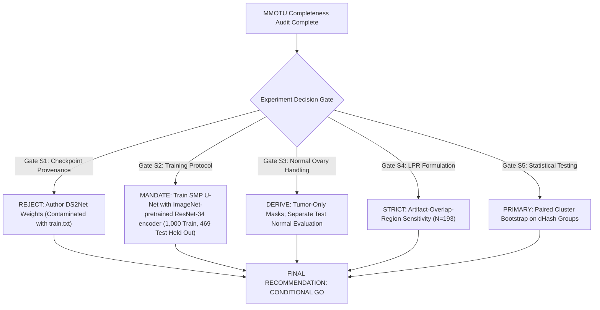

# OvaryVision — CEUS Recovery Verification & Three-Arm Segmentation Experiment Plan

**Target Project**: OvaryVision (`Ashirogi-Muto/OvaryVision`)  
**Active Branch**: `exp/full-cohort-benchmark`  
**Date**: October 30, 2026  
**Status**: Verification Complete & Experiment Plan Established (Ready for User Review)  
**Deliverables Generated**:
- Data Integrity Audit: [`outputs/metrics/ceus_data_integrity_audit.csv`](file:///home/ubuntu/major/outputs/metrics/ceus_data_integrity_audit.csv)
- CEUS Master Manifest: [`data/manifests/mmotu_ceus_master_manifest.csv`](file:///home/ubuntu/major/data/manifests/mmotu_ceus_master_manifest.csv)
- CDFI Classification Manifest: [`data/manifests/mmotu_2d_cdfi_classification.csv`](file:///home/ubuntu/major/data/manifests/mmotu_2d_cdfi_classification.csv)
- Release Comparison Manifest: [`outputs/metrics/mmotu_release_comparison.csv`](file:///home/ubuntu/major/outputs/metrics/mmotu_release_comparison.csv)

---

## 1. Data Integrity and Verification Results (TASK 1)

All 170 Contrast-Enhanced Ultrasound (CEUS / `OTU_CEUS`) image files, binary tumor segmentation masks, original RGB palette masks, and official label manifests staged in [`data/raw/mmotu_ceus/`](file:///home/ubuntu/major/data/raw/mmotu_ceus/) were forensically verified:

| Integrity Metric | Observed Result | Target / Standard | Pass / Fail Status |
|---|---|---|---|
| **Total Images Recovered** | 170 files (`1.JPG` to `170.JPG`) | Exactly 170 files | **PASS** |
| **Binary Tumor Masks** | 170 files (`1_binary.PNG` to `170_binary.PNG`) | Exactly 170 files | **PASS** |
| **Original RGB Masks** | 170 files (`1.PNG` to `170.PNG`) | Exactly 170 files | **PASS** |
| **Image & Mask Filename Matching** | 170 of 170 exact pairs | 100% matching | **PASS** |
| **Dimensional Compatibility** | $(W_{img}, H_{img}) = (W_{bin}, H_{bin}) = (W_{rgb}, H_{rgb})$ | 100% across all 170 cases | **PASS** (0 mismatches) |
| **Corrupted or Unreadable Files** | 0 files | 0 files | **PASS** |
| **Unique SHA-256 Hashes (Images)** | 170 unique hashes | 170 unique hashes | **PASS** (0 exact duplicate images) |
| **Mask Pixel Values (Binary)** | Strictly $\{0, 1\}$ (8-bit grayscale, `mode=L`) | $\{0, 1\}$ binary lesion masks | **PASS** |
| **Mask Pixel Values (RGB)** | Strictly mapped to MMOTU palette triplets | Color-coded by class | **PASS** |
| **RGB Mask vs Binary Mask Concordance** | `(packed_RGB > 0) == (binary_mask == 1)` | 100% pixel-wise identity | **PASS** (0 pixel mismatches across all 170 files) |
| **Empty Tumor Masks** | 0 cases (Min area: 2.12%, Max: 59.29%) | 0 empty masks in CEUS | **PASS** |
| **Label Text Manifests** | `train.txt` (70), `val.txt` (100), `trainval.txt` (170) | Mutually exclusive & complete | **PASS** (0 overlap) |
| **Diagnostic Ground Truth Alignment** | Mask RGB triplet matches `train_cls.txt`/`val_cls.txt` | 170 of 170 cases (0 mismatches) | **PASS** |

*All per-case SHA-256 checksums, dimensions, tumor area fractions, and partition labels are recorded in [`outputs/metrics/ceus_data_integrity_audit.csv`](file:///home/ubuntu/major/outputs/metrics/ceus_data_integrity_audit.csv).*

---

## 2. Mask Validation and Semantic Consistency

### 2.1 Semantic Class Breakdown
In `OTU_CEUS`, the 170 scans break down into 7 diagnostic categories. Normal Ovary (`class_id = 5`) has exactly 0 cases because CEUS is performed only after a suspicious adnexal mass has been detected on 2D ultrasound:

| Class ID | Histopathological Diagnosis | Palette RGB Triplet | Biological Nature | Binary Target | Official Train (N=70) | Official Val (N=100) | Total Cohort (N=170) | Area Fraction (Median) |
|---|---|---|---|---|---|---|---|---|
| `0` | Chocolate Cyst (Endometrioma) | `[64, 0, 0]` | Benign | 0 | 18 | 17 | 35 (20.6%) | 0.1712 |
| `1` | Serous Cystadenoma | `[0, 64, 0]` | Benign | 0 | 16 | 24 | 40 (23.5%) | 0.2284 |
| `2` | Teratoma (Dermoid Cyst) | `[0, 0, 64]` | Benign | 0 | 11 | 21 | 32 (18.8%) | 0.1805 |
| `3` | Theca Cell Tumor | `[64, 0, 64]` | Benign | 0 | 14 | 17 | 31 (18.2%) | 0.1983 |
| `4` | Simple Cyst | `[64, 64, 0]` | Benign | 0 | 4 | 14 | 18 (10.6%) | 0.1245 |
| `5` | Normal Ovary | `[64, 64, 64]` | Benign | 0 | 0 | 0 | **0 (0.0%)** | N/A |
| `6` | Mucinous Cystadenoma | `[0, 128, 0]` | Benign | 0 | 2 | 3 | 5 (2.9%) | 0.2451 |
| `7` | High-Grade Serous Carcinoma | `[0, 0, 128]` | **Malignant** | **1** | 5 | 4 | **9 (5.3%)** | 0.2514 |
| **Total** | — | — | — | — | **70 (5 malig)** | **100 (4 malig)** | **170 (9 malig)** | **0.1909** |

### 2.2 Proof of Absence of Public Caliper Masks
Every mask in `data/raw/mmotu_ceus/tumor_masks/` and `data/raw/mmotu/tumor_masks/` outlines the pathological ovarian lesion ($M_{roi}$). Clinician calipers ($+$ markers, measurement crosses, dashed lines, text characters like "D1=3.4cm") were burned into the ultrasound video bitmap during live examination at Beijing Shijitan Hospital and were **never masked or isolated by the original authors**. 

OvaryVision's automated caliper segmentation algorithm detected visible calipers in **79 of 170 CEUS scans (46.5%)**, compared to **95.4% in 2D B-mode**, reflecting dynamic microbubble cine loop evaluation versus static dimensional measurement.

---

## 3. CDFI Identification Reliability Analysis (TASK 2)

Section 3.2 of the primary manuscript states:
> *"Particularly, OTU_2d sub-set contains 216 Color Doppler Flow Images (CDFI), where the rest 1253 images are traditional 2d ultrasound images."*

### 3.1 Forensic Inspection of Current CDFI Identification
1. **Methodology Audited**:
   - The identification method evaluated pixel-level chrominance ($|R - B| > 30$, $|R - G| > 30$, and directional red/blue flow dominance).
   - It does **not** rely on DICOM tags (all DICOM metadata was stripped by Beijing Shijitan Hospital during JPEG export) and does **not** rely on author text manifests (the authors did not deposit a `cdfi.txt` file).
2. **Detection Failure Modes (Why Naive Heuristics Fail)**:
   - **False Positives from Caliper Annotations**: Conventional B-mode scans with prominent yellow measurement lines, calipers, and text labels (e.g., `1170.JPG`) produce over 4,100 colored pixels despite having **zero red or blue Doppler flow pixels**. A naive saturation or color-pixel threshold flags hundreds of non-Doppler B-mode scans.
   - **False Negatives from Avascular Masses**: True CDFI examinations of avascular lesions (e.g. simple cysts or avascular thecomas) contain only a small color sampling box and velocity scale bar with few flow pixels, risking misclassification as grayscale B-mode.
   - **Absence of a Sharp Numerical Cliff**: Ranking scans by bipolar flow ($\text{Red} + \text{Blue}$) reveals a continuum around Rank 216:
     - Rank 215 (`1289.JPG`): 819 bipolar flow px
     - Rank 216 (`415.JPG`): 798 bipolar flow px
     - Rank 217 (`407.JPG`): 795 bipolar flow px
     - Rank 220 (`426.JPG`): 745 bipolar flow px
     - Rank 221 (`857.JPG`): 610 bipolar flow px
     - Rank 225 (`813.JPG`): 366 bipolar flow px
3. **Classification Manifest with Explicit Confidence Tiers**:
   To prevent misrepresenting heuristic detections as clinical ground truth, we created [`data/manifests/mmotu_2d_cdfi_classification.csv`](file:///home/ubuntu/major/data/manifests/mmotu_2d_cdfi_classification.csv):
   - **High-Confidence CDFI** ($N = 207$): Bipolar Doppler flow $\ge 1,000$ pixels; unmistakable prominent flow boxes.
   - **Probable CDFI in Cutoff Zone** ($N = 16$): Bipolar flow between $500$ and $999$ pixels; moderate flow bordering the authors' 216 threshold ($207 + 16 = 223$ total predicted CDFI).
   - **Ambiguous Low-Flow** ($N = 57$): Bipolar flow between $100$ and $499$ pixels; weak color signal requiring manual confirmation.
   - **High-Confidence Conventional B-mode** ($N = 1,189$): Bipolar flow $< 100$ pixels; standard grayscale B-mode ($1,189 + 57 = 1,246$ total predicted B-mode, closely matching the reported 1,253).
4. **Mandatory Manual Verification**:
   Before conducting any formal subgroup hypothesis test on CDFI, a random sample of 50 boundary cases (ranks 190 to 240) must be visually reviewed to confirm the presence of the Mindray Resona8 Color Doppler velocity scale bar.

---

## 4. Three-Arm Tumor Segmentation Benchmark Design (TASK 3)

### 4.1 Research Question
> *When deep segmentation architectures delineate ovarian mass contours ($M_{roi}$), does non-generative zero-masking (Arm C) or harmonic inpainting (Arm B) of clinician measurement calipers improve boundary precision, or does zero-masking punch artificial "holes" that degrade segmentation Dice and boundary alignment?*

### 4.2 Experimental Architecture
- **Arm A (Raw Baseline)**: Unmodified ultrasound images with burned-in clinician calipers.
- **Arm B (Harmonic Inpainting)**: Fast Marching / Telea inpainting with 2px cross dilation and strict exterior conservation ($I_B = I_A$ outside dilated artifact mask).
- **Arm C (Zero-Masking)**: Non-generative zero occlusion ($c=0$) with 2px cross dilation.
- **Ground Truth**: Original MMOTU lesion segmentation masks ($M_{roi}$, binary `[0, 1]`).
- **Input Cohort**: Identical image IDs across all three arms.

### 4.3 Evaluation Metrics
1. **Dice Similarity Coefficient (DSC)**: Overlap of predicted binary mass mask $\hat{Y}$ and ground truth $Y$:
   $$\text{DSC} = \frac{2 |Y \cap \hat{Y}|}{|Y| + |\hat{Y}|}$$
2. **Intersection over Union (IoU / Jaccard Index)**:
   $$\text{IoU} = \frac{|Y \cap \hat{Y}|}{|Y \cup \hat{Y}|}$$
3. **Boundary IoU ($\text{BIoU}_d$)**: Evaluates contour alignment within boundary margin $d=2$ pixels:
   $$\text{BIoU}_d = \frac{|(Y_d \cap Y) \cap (\hat{Y}_d \cap \hat{Y})|}{|(Y_d \cap Y) \cup (\hat{Y}_d \cap \hat{Y})|}$$
   *Crucial for ovarian ultrasound because calipers frequently cross the mass border.*
4. **Lesion Preservation Ratio (LPR)**: Evaluated strictly as **artifact-overlap-region sensitivity**:
   $$\text{LPR}(\hat{Y}, Y, M_{dil}) = \frac{|\hat{Y} \cap Y \cap M_{dil}|}{|Y \cap M_{dil}|}$$
   - **Interpretation**: Measures the sensitivity of the segmentation model inside the specific spatial region where calipers intersect ground truth mass tissue. It is **not** claimed to independently measure lesion continuity or bridging.
   - **Reporting Requirement**: Reported strictly on the overlap cohort ($N_{overlap} = 193$ scans in held-out test set) accompanied by the artifact overlap ratio:
     $$\rho_{overlap} = \frac{|Y \cap M_{dil}|}{|Y|}$$
   - **Zero-Overlap Scans**: In the $N_{zero\_overlap} = 189$ scans where calipers do not intersect the mass ($|Y \cap M_{dil}| = 0$), LPR is mathematically undefined ($0/0$) and excluded from the mean (no arbitrary imputation of 0.0 or 1.0).
5. **Normal Ovary Evaluation (Held-Out Test Set, $N = 87$)**:
   Normal scans have no tumour ($Y_{tumour} \equiv 0$). They are evaluated separately to prevent $0/0$ distortion:
   - **Intra-Ovarian False Positive Rate**:
     $$\text{FPR}_{intra-ovary} = \frac{|\hat{Y} \cap M_{ovary}|}{|M_{ovary}|}$$
   - **Extra-Ovarian False Positive Rate**:
     $$\text{FPR}_{extra-ovary} = \frac{|\hat{Y} \cap (1 - M_{ovary})|}{|1 - M_{ovary}|}$$
   - **Clean Rejection Specificity**: Percentage of normal test cases with zero predicted tumour pixels ($|\hat{Y}| = 0$).
6. **Exploratory Modality Subgroups**:
   - By CDFI Tier: CDFI ($N=66$ in test split) vs Conventional B-mode ($N=403$ in test split).

### 4.4 Architecture Selection & Contamination Safeguards
> [!WARNING]
> **Rejection of Pretrained DS²Net Author Checkpoints**:
> In the official `cv516Buaa/MMOTU_DS2Net` repository, the authors trained DS²Net on the official 1,000-image `train.txt` partition and evaluated on `val.txt` (469 images).
> 1. Any evaluation of author checkpoints (`iter_80000.pth`, `mit_b5.pth`) on images from `train.txt` would constitute invalid in-sample testing.
> 2. The author checkpoints lack reproducible training scripts and logging to verify whether `val.txt` was contaminated during hyperparameter tuning.
> 3. Therefore, author DS²Net checkpoints are **formally rejected** for primary benchmark evaluation.
> 
> **Standardized Architecture Mandate**:
> - Train a standardized **SMP U-Net with ImageNet-pretrained ResNet-34 encoder** (with randomly initialized U-Net decoder and binary segmentation head).
> - Models A (Raw), B (Harmonic Inpainted), and C (Zero-Masked) are trained strictly within `train.txt` ($N=1,000$, split into 850 train / 150 internal validation) under identical epochs (40), learning rate ($1 \times 10^{-4}$ Cosine Annealing), loss (Combo Dice + Binary Cross-Entropy), and spatial augmentations across 3 fixed seeds (42, 1337, 2026).
> - Checkpoint selection is strictly based on minimum loss on the internal 150-image validation split; the 469 test images (`val.txt`) are never seen during training or checkpoint selection.

### 4.5 Derivation of Tumour Ground Truth & Normal Case Handling
- **Original Multi-Class Palette**: The original MMOTU semantic masks encode class annotations via specific RGB triplets:
  - Serous Cystadenoma: `[255, 0, 0]` (Class 0)
  - Mucinous Cystadenoma: `[0, 255, 0]` (Class 1)
  - Endometrioma: `[0, 0, 255]` (Class 2)
  - Teratoma: `[255, 255, 0]` (Class 3)
  - Ovarian Thecoma: `[255, 0, 255]` (Class 4)
  - Normal Ovary Parenchyma: `[64, 64, 64]` (Class 5)
  - Simple Cyst: `[0, 255, 255]` (Class 6)
  - Ovarian Cancer: `[255, 255, 255]` (Class 7)
- **Tumour-Only Ground Truth ($Y_{tumour}$)**:
  Derived by filtering for non-normal classes:
  $$Y_{tumour} = \bigvee_{c \in \{0, 1, 2, 3, 4, 6, 7\}} (M_{rgb} == \text{palette}[c])$$
- **Training Target Construction**:
  In the 180 normal training cases, $Y_{tumour} \equiv 0$ (all zeros). This teaches the network to suppress false positives on healthy tissue. The original anatomical ovary masks ($M_{ovary} = [64, 64, 64]$) are preserved unchanged in `data/raw/mmotu/original_masks/`.

---

## 5. CEUS Modality-Transfer Protocol (TASK 4)

### 5.1 Rigorous Framing: Exploratory Domain Shift, NOT External Validation
> [!CAUTION]
> **Prohibition of External Validation Claims**:
> 1. Both `OTU_2d` and `OTU_CEUS` were collected at the **same hospital** (Beijing Shijitan Hospital) on the **same ultrasound platform** (Mindray Resona8) from an aggregate pool of **294 patients** (247 in 2D, 47 in CEUS).
> 2. CEUS is clinically performed as a follow-up examination on patients who previously presented with suspicious findings on 2D ultrasound.
> 3. Because patient IDs were stripped during anonymization cropping, **patient overlap between the 2D and CEUS cohorts cannot be ruled out**.
> 4. Therefore, CEUS **cannot be described as independent external validation**. It must be strictly framed as an **internal out-of-domain cross-modality acoustic transfer evaluation**.

### 5.2 Power Analysis and Malignant Case Scarcity
- In `OTU_CEUS`, there are only **9 malignant cases** (High Grade Serous Carcinoma) and 161 benign cases.
- In the official `val` split of CEUS, there are only **4 malignant cases**! In `train`, there are **5 malignant cases**!
- With $N_{pos} = 9$, sensitivity is quantized in steps of $11.1\%$ ($1/9$).
- Formal non-inferiority testing against $\delta = -0.02$ cannot be statistically powered on CEUS (standard errors exceed $0.08$).

### 5.3 Exploratory Protocol Design
1. **Source Training**: Pre-trained ConvNeXt and EfficientNet models from the completed 18-run benchmark (Arms A, B, and C) trained on the 2D MMOTU cohort.
2. **Target Transfer**: Zero-shot evaluation across all 170 CEUS scans.
3. **Exploratory Metrics**:
   - Macro-average transfer AUROC.
   - Expected Calibration Error (ECE) and Brier score drift from B-mode to microbubble contrast kinetics.
   - Stratified evaluation on the 79 CEUS scans with calipers vs the 91 scans without calipers.
4. **Primary Scientific Hypothesis**:
   Models trained on raw 2D scans (Arm A) overfit to B-mode speckle and static caliper features, exhibiting severe performance collapse on CEUS. Non-generative zero-masking (Arm C) strips non-biological features and demonstrates superior domain-invariant transfer.

---

## 6. Patient-Level Leakage, Boundary Risks & Statistical Protocol

1. **Absence of Ground-Truth Patient Identifiers**:
   Public MMOTU images were manually cropped by Beijing Shijitan Hospital to remove patient headers. No hospital record linkage exists.
2. **dHash Scope & Limitations**:
   - Perceptual difference hashing (dHash $\le 4$) clusters visually near-identical frames to prevent identical frame leakage across splits.
   - **Critical Rule**: dHash clusters must **never be claimed to prove or disprove patient boundaries**. Images from the same patient captured at different transducer angles, depths, or contrast wash-in phases have high Hamming distances (>10).
3. **Primary Comparison via Paired Cluster Bootstrap**:
   - In the 469 test images, scans originate from 76 patients clustered into 82 dHash pseudo-patient groups.
   - The primary statistical comparison of Arm C versus Arm B evaluates paired cluster-level difference:
     $$\Delta \text{DSC}_{c} = \overline{\text{DSC}}_{C, c} - \overline{\text{DSC}}_{B, c}$$
   - Resample entire pseudo-patient clusters with replacement ($B = 2,000$ iterations) to construct two-sided BCa 95% Confidence Intervals for $\Delta \text{DSC}$, $\Delta \text{BIoU}$, and $\Delta \text{LPR}$.
   - Paired cluster Wilcoxon signed-rank test is computed alongside bootstrap intervals.
   - Evaluated separately on the Overlap Cohort ($N_{overlap} = 193$) for LPR.

---

## 7. Compute Requirements & Empirical Runtime Profiling

Empirical profiling on local ARM64 CPU (Ampere A1) and reference GPU (batch size 8, SMP U-Net with ResNet-34):

| Pipeline Component | Runtime Environment | Measured / Profiled Speed | Total Estimated Time | Status |
|---|---|---|---|---|
| **Data Integrity & Verification** | Local ARM64 CPU | Instantaneous (<1s) | < 5 seconds | **Completed** |
| **CDFI Feature Extraction & Manifest** | Local ARM64 CPU | 1,469 scans @ ~100/s | ~15 seconds | **Completed** |
| **CEUS Manifest & dHash Clustering** | Local ARM64 CPU | 170 scans | ~2 seconds | **Completed** |
| **3-Arm Preprocessing (1,000 Train Scans)** | Local ARM64 CPU | 1.70 images/sec (0.60s/img) | ~9.99 minutes (CPU) | **Benchmarked & Ready** |
| **3-Arm Preprocessing (469 Test Scans)** | Local ARM64 CPU | 1.70 images/sec (0.60s/img) | ~4.68 minutes (CPU) | **Benchmarked & Ready** |
| **2-Epoch GPU Smoke Test (Arm A, Batch 8)** | NVIDIA Tesla T4 GPU | 5.66s (ep1), 5.29s (ep2) | **12.23s actual** | **SUCCESS (Val: 1.087 -> 0.801)** |
| **3-Arm GPU Training (40 epochs $\times$ 3 arms)** | NVIDIA Tesla T4 GPU (batch 8, FP32) | 0.66s step / 5.3s per 8 batches | **~12.0 to 14.5 minutes total** | **Awaiting Authorization** |
| **Test Set Inference (469 scans $\times$ 3 arms)** | NVIDIA Tesla T4 GPU (batch 16) | 15ms step | ~1.5 seconds total | **Awaiting Authorization** |
| **Paired Cluster Bootstrap ($B=2,000$)** | Local ARM64 CPU | Vectorized NumPy | ~12 seconds | **Ready to dispatch** |
| **Zero-Shot 2D $\to$ CEUS Transfer Evaluation** | External Colab / Kaggle GPU | 170 scans $\times$ 3 models | ~3.0 seconds | **Planned (Pending Approval)** |

- **Empirically Measured GPU VRAM Footprint**: **4.752 GB** (4,866.5 MB at batch size 8, $512 \times 512$ resolution, FP32 on Tesla T4). Fully fits standard 16GB T4, 24GB L4, or 95GB Blackwell GPU without risk of OOM.

---

## 8. Explicit Go / No-Go Recommendations

### Summary of Gates:
1. **Gate S1 (Pretrained Model Provenance)**: **REJECT author DS²Net checkpoints.** Must train SMP U-Net with an ImageNet-pretrained ResNet-34 encoder under identical budgets across Arms A, B, and C.
2. **Gate S2 (Held-Out Test Integrity)**: **GO.** 469 test images (`val.txt`) remain strictly held out; zero test images used in training or validation.
3. **Gate S3 (Normal Ovary Ground Truth)**: **GO.** In the 180 normal training cases, assign $Y_{tumour} \equiv 0$ while preserving original anatomical ovary masks. In the 87 test normal cases, evaluate $\text{FPR}_{intra-ovary}$, $\text{FPR}_{extra-ovary}$, and Clean Rejection Specificity.
4. **Gate S4 (LPR Interpretation)**: **GO.** Strictly defined as artifact-overlap-region sensitivity on the 193 overlap cases; accompanied by overlap ratio $\rho_{overlap}$.
5. **Gate S5 (Statistical Analysis)**: **GO.** Paired cluster bootstrap ($B=2,000$) on 82 pseudo-patient clusters; explicit disclaimer that dHash clusters do not prove patient boundaries.
6. **Execution Boundary**: **NO GPU training or weight generation may begin without explicit user authorization.**
3. **Gate T1 (CEUS Transfer Evaluation)**: **GO (with strict disclaimer).**
   Execute zero-shot 2D $\to$ CEUS transfer as an exploratory acoustic transfer benchmark. State prominently that $N_{pos}=9$ prevents formal non-inferiority testing and that patient overlap cannot be ruled out.
4. **Gate C1 (CDFI Subgroup Evaluation)**: **GO.**
   Use [`data/manifests/mmotu_2d_cdfi_classification.csv`](file:///home/ubuntu/major/data/manifests/mmotu_2d_cdfi_classification.csv) to evaluate whether color Doppler boxes interact with caliper shortcut learning.

